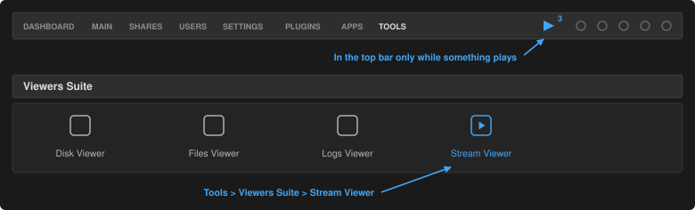
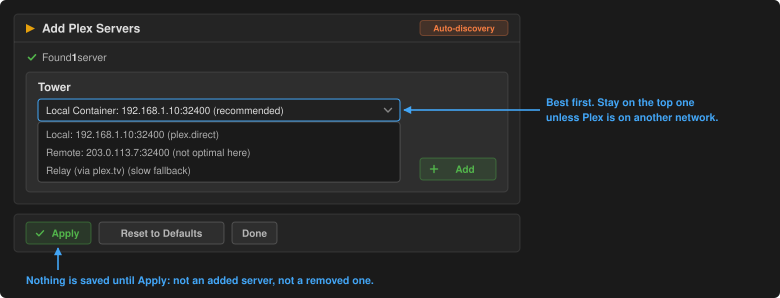
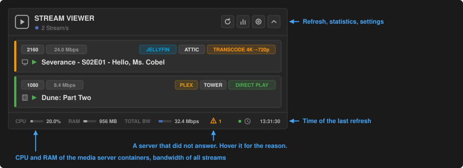
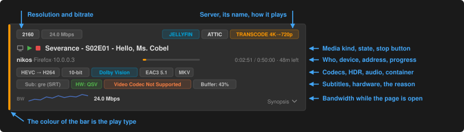
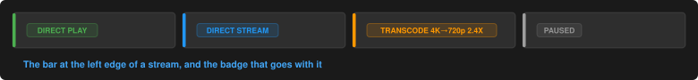
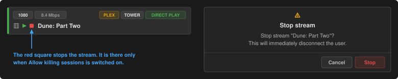
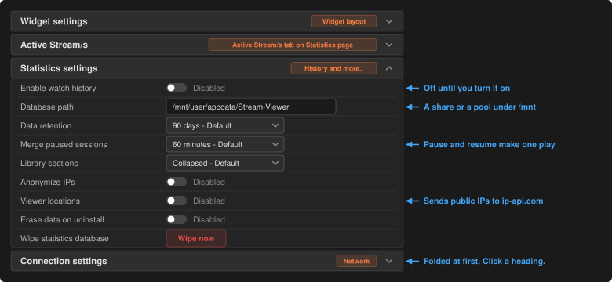
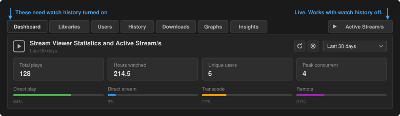

# Stream Viewer, a short guide

Stream Viewer shows who is watching what on your Plex, Jellyfin and Emby
servers, and can keep a history of it. This walks through the parts that are
not obvious the first time.

## Finding it

It lives in four places.

The tile on the **Dashboard** lists what is playing right now. The three icons
in its header are refresh, the chart that opens the statistics page and the
cog for the settings.

**Tools > Viewers Suite > Stream Viewer** is the statistics page. The live
view, **Active Stream/s**, is the tab at the right end of its tab bar.

**Settings > Stream Viewer Settings**, in the User Utilities group, is where
servers are added and everything else is switched on or off.

While something is playing, a play icon with the number of streams sits in the
top bar of the webGUI. Click it for the statistics page. It is checked less
often than the tile, so it can show up or go a minute late. The Header stream
badge setting removes it.

## Adding a server

Until there is a server, the tile only says "No media servers configured". The
settings page has four tabs: **Settings**, **Plex**, **Jellyfin** and **Emby**.

On the Plex tab, press **Connect with Plex**. A new browser tab opens at
plex.tv, you sign in there and allow Stream Viewer, and the servers of that
account are listed back on the settings page. Each comes with a list of
addresses, best first, and the line under the list says what the selected one
means. Leave it on the first unless you have a reason: Remote goes out through
your router and Relay through plex.tv, and both are meant for a Plex that
really is on another network. Then press **Add**. The plex.tv sign-in itself
is not kept, only the access key of each server you add.

On the Jellyfin and Emby tabs, give the server a name, its address, for
example `http://192.168.1.10:8096`, and an API key. The key is made on the
server itself, in its dashboard under API Keys. **Test Connection** tries the
address and the key before you add them.

Nothing is saved until you press **Apply**. That goes for a server you added,
removed, renamed or switched off with the tick next to its name. Up to ten
servers fit. **Reset to Defaults** puts every switch of the Settings tab back,
which turns watch history off as well, and leaves your servers alone. It waits
for Apply too.

If the test cannot connect and the server is a container on a custom Docker
network (ipvlan or macvlan), Unraid itself is not allowed to reach it until
you turn on **Settings > Docker > Host access to custom networks**. Docker has
to be stopped to change that, and the option shows in Advanced View.

Certificates are not checked by default, which is what a self-signed one
needs. If your servers have proper certificates, turn on **Verify SSL
certificates** under Connection settings.

## The tile

The header counts every stream on every server. The list under it shows the
first ten, transcodes first, and **Max streams shown** changes that number.

The tile asks the servers again every 30 seconds and stops asking while its
browser tab is in the background. The refresh icon asks at once.

While something plays, the bottom left shows the CPU and memory of your media
server containers and the bandwidth of all streams together. CPU and memory
are read from Docker on this Unraid, so a server that runs somewhere else
shows neither, and the CPU figure is a share of the whole machine. **Network
bandwidth capacity** is what a full TOTAL BW bar stands for. It starts at
1000 Mbps. Set it to what your line really carries and the bar means
something.

A warning triangle with a number means that many servers did not answer. Hover
it and it names them, each with the reason. The clock at the right is the time
of the last refresh.

With nothing playing the tile says so and, when watch history is on, adds who
watched what last.

## Reading a stream

Top left is the resolution of the file and the bitrate. Top right is the kind
of server, the name you gave it and how the stream plays, which is what the
next section is about.

The icons before the title are the kind of media and whether it is playing or
paused. Under the title come the user, the device and the address they watch
from, then the position, the length and the time left.

The small boxes describe the file: video codec, bit depth, HDR, audio,
container, subtitles. When the server converts the video, the codec box shows
both sides, as in `HEVC → H264`, and the HW box names the hardware doing it,
or says SW when it is done in software. For Jellyfin the name is the hardware
the server is set to use. For Emby the box says YES when the server does not
name the hardware. Jellyfin and Emby also give the reason for a transcode and
how much of the file is converted so far (Buffer). Plex gives a speed on the
play type badge instead. 2.4x means it converts 2.4 times faster than it
plays, and a figure that stays under 1.0x means the server cannot keep up.

**BW** is the bandwidth of that one stream, with a small chart. The chart
starts when you open the page. It is not history. **Synopsis** opens the cover
and the description.

Most parts have their own Show switch under Widget settings. **Show IP
address** is the one to turn off when the dashboard is on a screen other
people see.

## Play types

The bar down the left edge of a stream is the quickest thing to read.

**Direct play**, green: the file goes to the player as it is.

**Direct stream**, blue: the video is left alone and the server only repacks
the file or converts the audio. Light work.

**Transcode**, orange: the server re-encodes the video. This is the one that
takes CPU or GPU, and the badge adds from what resolution to what.

**Paused**, grey, whatever it was before.

Transcodes are listed first, then direct streams, then direct plays.

## Stopping a stream

Off by default. **Allow killing sessions** exists twice, under Widget settings
for the tile and under Active Stream/s for that tab, so the button can be in
one place and not in the other.

With it on, every stream gets a small red square next to its title. It asks
first, and on Stop the viewer is cut off at once. A Plex viewer is shown the
message "Stream terminated by Unraid administrator". On Jellyfin and Emby
playback simply stops.

Plex offers this to servers with a Plex Pass only. If a server refuses, a
message says what it answered.

## Watch history

Everything so far works as soon as a server is added. The statistics do not:
nothing is recorded until you turn on **Enable watch history**, in the
**Statistics settings** section of the Settings tab. Three of the four
sections on that tab start folded, this one among them. Click a heading to
open it.

From then on a small recorder looks at your servers once a minute, with or
without a browser open, for as long as the array is started. What it sees goes
into an SQLite database in the **Database path**, which has to be a folder on
a share or a pool under `/mnt`, not in RAM and not on the flash drive. The
default is `/mnt/user/appdata/Stream-Viewer`. If you do not use user shares,
point it at a pool or a disk.

History starts at that moment. Plays from before are not brought in from the
servers. Downloads are the exception: the first look goes back seven days.

**Data retention** drops records older than 90 days, or whatever you pick,
Unlimited included. Changing the path starts a new, empty database and leaves
the old one where it was. **Wipe now** empties the current one and keeps your
settings.

## What counts as a play

A play is counted when it ends, so something still running is not in the
totals yet.

Time spent paused is taken off its length. A play that comes out shorter than
30 seconds is not kept, and one that starts and stops between two looks of the
recorder is never seen at all.

Stop halfway and pick the film up again later, or drop out and reconnect, and
the server reports two sessions. **Merge paused sessions** joins them back
into one play when the same user returns to the same title on the same server
within the window, which is 60 minutes unless you change it.

If a server stops answering, its open streams are held for ten minutes before
they are closed, so restarting a container does not cut every play in two.

## The statistics page

**Tools > Viewers Suite > Stream Viewer**, or the chart icon on the tile.

Seven tabs need watch history turned on.

**Dashboard** has the totals: plays, hours, users, the busiest moment, how
much was direct play, direct stream, transcode and remote, which means watched
from outside your network, and what was watched most and by whom.

**Libraries** shows what each server holds and how much of it has been
watched, plus the latest additions. It is read from the servers when you open
the tab, at most once every five minutes. The refresh icon on that tab reads
it now.

**Users** has the same figures per person, and **Graphs** draws the history as
charts.

**History** is every play, with filters and a search box. **Export CSV** saves
what the filters show, newest first, up to 1,000 rows.

**Downloads** lists files taken for offline use from Jellyfin and Emby. Plex
keeps no log of them, so Plex servers are not in this tab.

**Insights** points at three things: titles that keep being started and
dropped within two minutes, which usually means playback trouble, users who
watched nothing in the period, and how much of everything needed a transcode.

The period selector belongs to the tab it is on. Changing it on one tab leaves
the others alone.

With watch history off these tabs only say so and link to the settings. With
the array stopped they say the database is not available, because the disk it
is on is not mounted.

## Active Stream/s

The tab at the right end of the same page is the tile with more room. Every
stream is a larger card with its cover, and across the top are the number of
streams and of users, the average bitrate, how many are buffering, and the
CPU, memory and bandwidth totals.

It works with watch history off, and it refreshes every 5 seconds while you
are on it. It has its own copy of the display switches, under **Active
Stream/s** in the Settings tab, so it can show more than the tile does.

## Viewer locations

Two cards on the Graphs tab, **Plays by country** and **Top locations**, stay
empty until you turn on **Viewer locations** in the Statistics settings.

It is off by default because it hands something about your viewers to a third
party. With it on, the public IP address of every remote viewer in the history
is sent to ip-api.com, a lookup service, over plain HTTP, and the country and
city that come back are kept in your database. Its free service, the one used
here, is for non-commercial use. Addresses on your own network are never sent,
and each address is looked up once.

Turning it off stops the lookups and keeps what was already found.

**Anonymize IPs** is a separate switch. From the moment it is on, the last
part of every address is blanked before it is stored. With both on, the
blanked address is the one that gets looked up.

Apart from this, Stream Viewer talks only to your own media servers and, for
Plex, to plex.tv to find them.

## When a server moves

Containers get new addresses. When a server fails three checks in a row,
Stream Viewer looks for it again: a Plex server through plex.tv, a Jellyfin or
Emby server among the containers on this Unraid. The new address is saved only
after it has answered, so a wrong guess changes nothing.

A server that took long to fail is left alone for 30 seconds, so that one dead
server does not slow the tile down for the rest.

The Plex tab may show a banner, **Local Plex container detected**. It means
Plex runs on this Unraid but is reached the long way round, through a remote
address. **Switch to local** corrects that at once, without waiting for
Apply.

## Themes

Stream Viewer follows the Unraid theme, light on White and Azure and dark on
Black and Gray, with nothing to set. **Badge color theme** only recolours the
server name badge.

## Where things are kept

The settings are one file on the flash drive,
`/boot/config/plugins/streamviewer/streamviewer.cfg`. It holds the access keys
of your servers, so a copy of it, or a flash backup, deserves the care of a
password.

The history is `streamviewer.db` in the Database path. Everything else, what
is playing now included, lives in RAM and is gone after a reboot.

Removing the plugin leaves the settings file and the database where they are,
so a reinstall picks up where you left off. **Erase data on uninstall** turns
that around: with it on, removal deletes both.

## When something looks wrong

**A server shows nothing and the warning triangle is on.** Hover the triangle
for the reason. "Invalid API key" means the server no longer accepts the key.
For Jellyfin and Emby, make a new one and type it into the Token / API Key box
of that server. For Plex, remove the server, sign in again and add it back.
Anything about connecting usually means the address changed or, for a
container on its own Docker network, that Host access to custom networks is
off.

**The tile says "Connection problem, retrying..."** This time it is the webGUI
that does not answer the tile, not your media servers. It retries by itself
and the clock shows in how many seconds.

**The statistics tabs stay empty.** Check that Enable watch history is on,
that the array is started and that the Database path is on a mounted share or
pool. Then play something for more than a minute and let it end.

**The tile is empty under the Neoraid theme.** Update Neoraid. Its versions
from 2026.11.18a on handle the tile.

For anything else, the Support link at the bottom of the settings page opens
the issue tracker.
