# Stream Viewer for Unraid

A real time media stream monitor and statistics tracker for Unraid. View active streams from your Plex, Jellyfin and Emby servers directly from the dashboard, and track watch history, library content and user activity through a dedicated statistics page.

<p align="center">
  &nbsp;
  &nbsp;
  &nbsp;
  &nbsp;
  
</p>

## Features

**Dashboard Widget**
- Monitor active streams in real-time from the Unraid dashboard
- Multi-server support for up to 10 Plex, Jellyfin and Emby servers simultaneously
- Stream details including user, device, IP address, playback progress, resolution and bitrate
- Custom SVG media type icons for movies, series, music and photos
- Visual indicators for Direct Play, Direct Stream, Transcode and Paused sessions, with transcodes listed first
- Technical details row per stream (video codec, bit depth, HDR, audio codec and channels, spatial audio, container, subtitles, hardware or software transcoding)
- Transcode speed badge for Plex, transcode reasons and buffer for Jellyfin and Emby
- Bandwidth per stream with a mini live chart
- Collapsible Synopsis section with thumbnail, description and dominant color tinting from cover art
- Footer with the total CPU and RAM of the media server containers and the total bandwidth of all streams
- Warning badge that names the servers that did not answer, each with the reason
- Stream count icon in the Unraid header bar while something is playing
- Last stream shown when nothing is playing (needs watch history)
- Optional stop button to end a stream directly from the widget
- Badge Color Theme picker with 12 color options for server name badges
- Configurable auto-refresh with adjustable polling interval
- Follows the Unraid theme, light and dark
- Mobile responsive layout

**Statistics Tool Page**

Under Tools > Viewers Suite > Stream Viewer. Every tab except Active Stream/s needs watch history, which is off by default.

- Dashboard tab with totals for the selected period, a daily streams chart, most watched titles, top users and recent history
- Libraries tab with server overview, collapsible sections, watched share and recently added items
- Users tab with per-user play counts, watch time, content breakdown, downloads and play type distribution
- History tab with full watch history, filters, search, pagination and CSV export
- Downloads tab with offline downloads from Jellyfin and Emby, most downloaded titles and top downloaders
- Graphs tab with 17 charts, from watch time and peak hours to bandwidth, resolutions and viewer locations
- Insights tab with buffering warnings, inactive users and transcode ratio
- Active Stream/s tab, the live view with larger cards and totals for streams, users, bitrate, buffering, CPU, RAM and bandwidth
- Recorder that checks the servers once a minute while the array is started, with or without a browser open
- SQLite database with automatic schema migration system
- Configurable data retention, merging of paused sessions and IP anonymization
- Optional lookup of viewer locations, off by default

**Server Integration**
- Plex sign-in at plex.tv with automatic server discovery. The account token is never stored
- Jellyfin and Emby by server URL and API key, with Test Connection before adding
- A server that moved is found again after three failed checks: Plex through plex.tv, Jellyfin and Emby among the Docker containers on the same Unraid
- Detection of a local Plex container that is reached through a remote address, with a one-click switch to the local one

## Guide

A short walkthrough of the parts that are not obvious the first time, from adding a server to what counts as a play, is in [GUIDE.md](GUIDE.md).

## Installation

Requires Unraid 7.2.0 or later.

**Via Community Applications (recommended)**
1. Open Community Applications in Unraid
2. Search for Stream Viewer
3. Click Install

**Manual Installation**
1. Go to Plugins in Unraid
2. Click Install Plugin
3. Paste the following URL:

```
https://raw.githubusercontent.com/Lazaros-Chalkidis/unraid-streamviewer/main/streamviewer.plg
```

## Configuration

After installation, go to Settings > Stream Viewer Settings, in the User Utilities group. The page has four tabs: Settings, Plex, Jellyfin and Emby. Nothing is saved until you press Apply. Reset to Defaults puts the switches of the Settings tab back and leaves your servers alone.

**Servers**

| Tab | How a server is added |
| --- | --- |
| Plex | Connect with Plex opens plex.tv in a new browser tab. Sign in and allow Stream Viewer, then pick an address for each server that is listed and press Add |
| Jellyfin | Display Name, Server URL and an API Key made in the server dashboard under API Keys. Test Connection tries them, Add Server adds the server |
| Emby | Same as Jellyfin |

Up to 10 servers in total. A configured server can be renamed, switched off or removed.

The Settings tab has four sections. Click a heading to open it.

**Widget settings**

| Setting | Default | Description |
| --- | --- | --- |
| Automatic refresh | Enabled | Poll the servers for new stream data |
| Refresh interval | 30s | How often to poll, from 5s to 300s |
| Max streams shown | 10 | All, 5, 10, 20 or 50 |
| Media summary default state | Collapsed | Whether the Synopsis of a stream starts open |
| Allow killing sessions | Disabled | Adds a stop button to every stream. It forcibly disconnects the viewer |
| Show device | Show | Client device name |
| Show IP address | Show | Viewer IP address. Hide it on shared screens |
| Show progress bar | Show | Playback position bar |
| Show quality / bitrate | Show | Resolution and live bitrate |
| Show transcode info | Show | Direct play, direct stream or transcode |
| Show technical details | Show | Codec, HDR, audio, container, subtitles, hardware |
| Show media summary | Show | Thumbnail and description |
| Show bandwidth chart | Show | Mini bandwidth chart in each stream |
| Show Docker stats | Show | CPU, RAM and total bandwidth in the footer |
| Network bandwidth capacity | 1000 Mbps | Ceiling for the TOTAL BW bar: 50, 100, 200, 500 or 1000 Mbps. Needs Docker stats on |
| Header stream badge | Show | Stream count icon in the Unraid header bar |
| Badge color theme | Default | Server name badge colors, 12 themes |

**Active Stream/s**

The same options for the Active Stream/s tab of the statistics page, kept separately from the widget: Automatic refresh, Refresh interval (default 5s), Max streams shown (default All), Allow killing sessions, the switches from Show device to Show bandwidth chart, and Badge color theme.

**Statistics settings**

| Setting | Default | Description |
| --- | --- | --- |
| Enable watch history | Disabled | Record plays and downloads to a local SQLite database |
| Database path | /mnt/user/appdata/Stream-Viewer | Folder of the database. Must be on a share or pool under /mnt/ |
| Data retention | 90 days | Older records are pruned: 7, 30, 90, 180 or 365 days, or Unlimited |
| Merge paused sessions | 60 minutes | Count pause and resume as one play within this window: Off, 15, 30 or 60 minutes, 2 or 4 hours |
| Library sections | Collapsed | Default state of the server sections on the Libraries tab |
| Anonymize IPs | Disabled | Mask the last part of the IP before storing it |
| Viewer locations | Disabled | Look up the country and city of remote viewers. When on, their public IP addresses are sent to ip-api.com over plain HTTP |
| Erase data on uninstall | Disabled | Delete database and settings when the plugin is removed. Off keeps both for a reinstall |
| Wipe statistics database | | Wipe now permanently deletes all collected history and keeps the settings |

**Connection settings**

| Setting | Default | Description |
| --- | --- | --- |
| Verify SSL certificates | Disabled | Certificate check for HTTPS server addresses. Leave off for self-signed certificates |

## Supported Servers

| Server | Active streams | Stop stream | Transcode detail | Downloads tab | Setup |
| --- | --- | --- | --- | --- | --- |
| Plex | Yes | Yes, with Plex Pass | Speed | No | Sign in at plex.tv |
| Jellyfin | Yes | Yes | Reasons, buffer | Yes | URL and API key |
| Emby | Yes | Yes | Reasons, buffer | Yes | URL and API key |

## Security

- CSRF token (nonce) protection on all API requests with a 4 hour sliding expiration
- Rate limiting (120 requests per minute per IP, the Docker stats poll is not counted)
- Origin validation blocks cross-origin requests
- HTTP method restriction (GET/POST only). Stopping a stream, wiping the database, switching a Plex address and testing a connection with a key need POST
- AJAX-only enforcement (X-Requested-With check) on everything except the image proxy
- Request values are validated before use: fixed lists for period, server type, play type and media type, clamped ranges for numbers
- SQLite queries get request values only as bound parameters of prepared statements, never as part of the SQL text
- LIKE wildcard escaping with explicit ESCAPE clause
- Docker container ID hex-only validation before it is used on the Docker socket
- URL validation on outbound HTTP requests
- Security headers on all JSON responses (X-Frame-Options, X-Content-Type-Options, CSP, X-XSS-Protection, Referrer-Policy) with Cache-Control: no-cache, must-revalidate
- Image proxy limited to poster images of the configured servers, or of a public plex.direct address. The access key of a configured server is added on the server side
- Proxied images must be JPEG, PNG, GIF or WebP, with a 5 MB size cap
- Plex account token never stored, only per-server access keys are saved
- Saved access keys are not printed back into the settings page
- Database file permissions restricted to owner only (0600)
- Cache directory created with restricted permissions (0700)
- Outbound connections go to the configured media servers, to plex.tv for Plex sign-in and discovery and, only with Viewer locations on, to ip-api.com
- The access keys of your servers are kept in the settings file on the flash drive, `/boot/config/plugins/streamviewer/streamviewer.cfg`. Treat a flash backup accordingly

## Screenshots

The pictures below were taken in March 2026, up to v2026.03.30. Tabs and settings have changed since. The drawings in the [guide](GUIDE.md) show the current layout.

**Dashboard Widget**

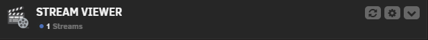
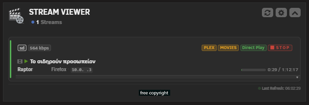
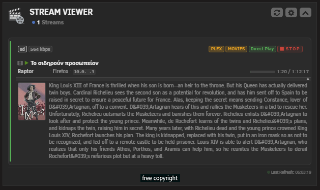
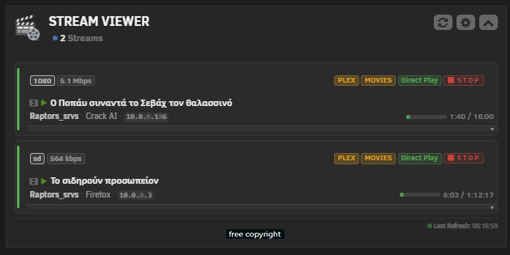

**Statistics Tool**

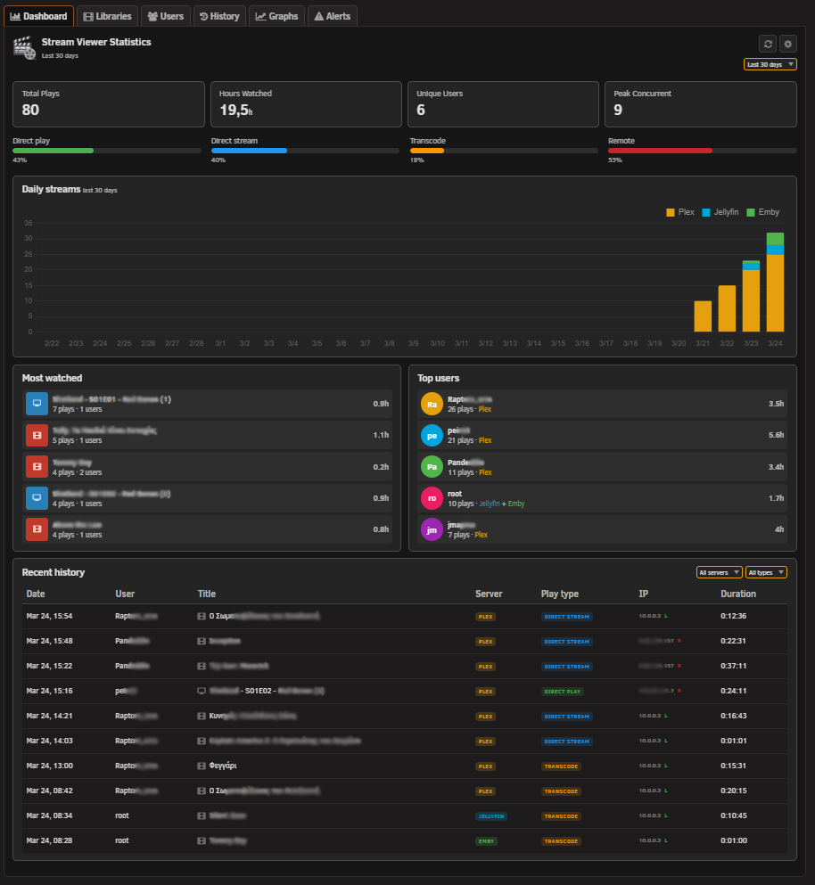
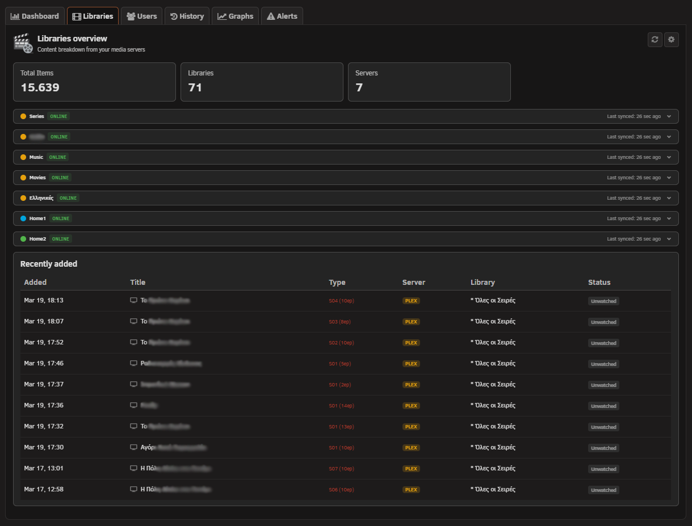
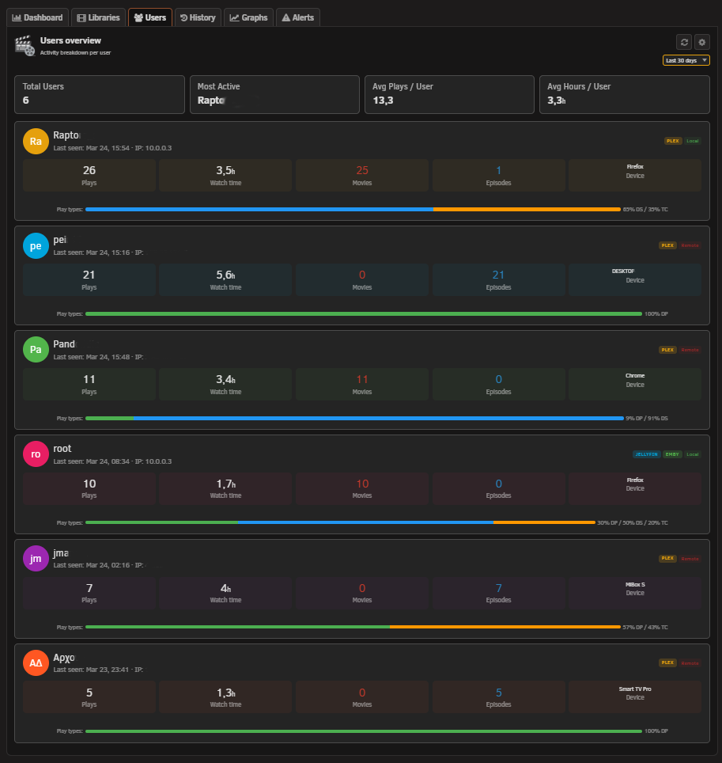
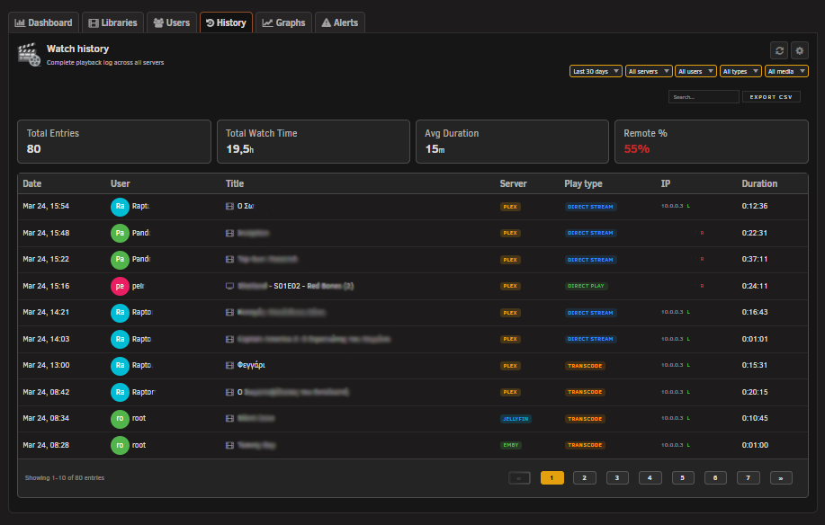
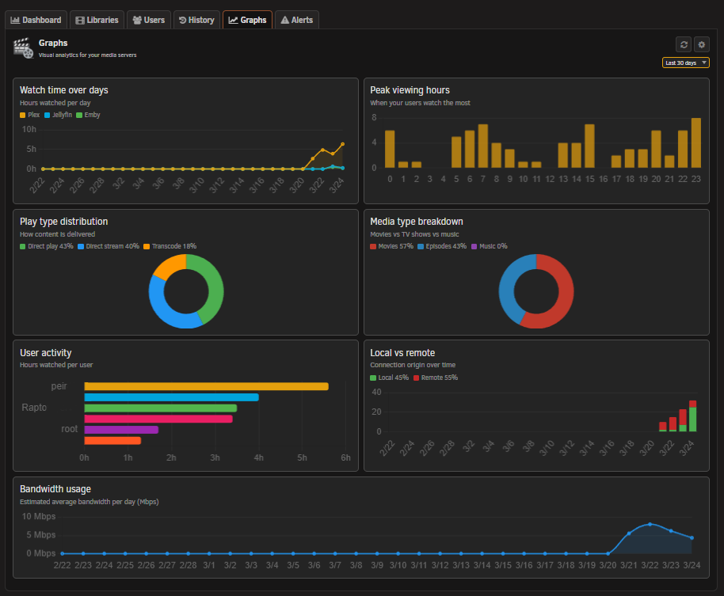
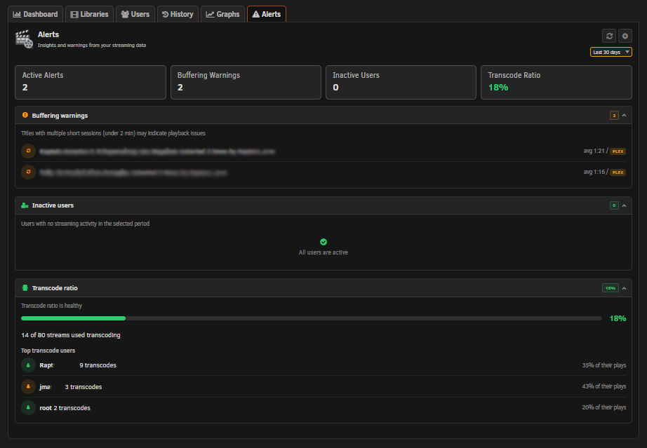

**Settings Page**

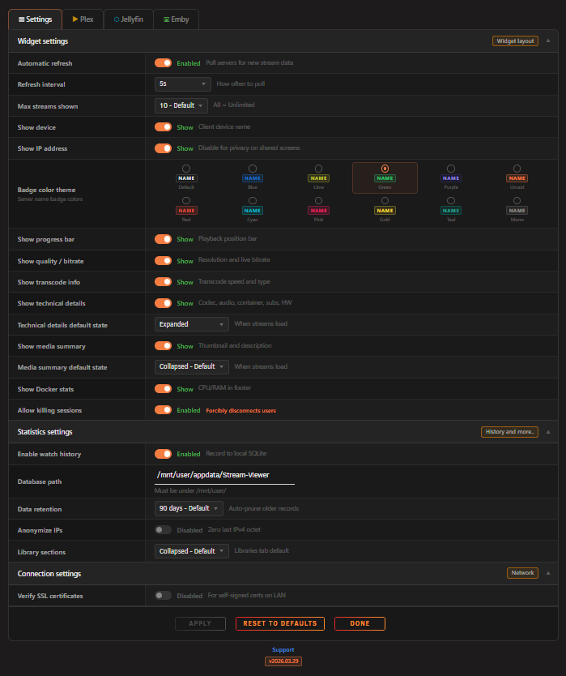
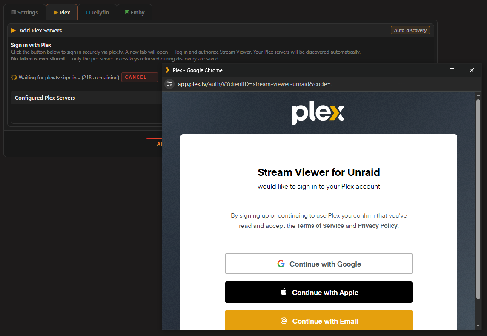
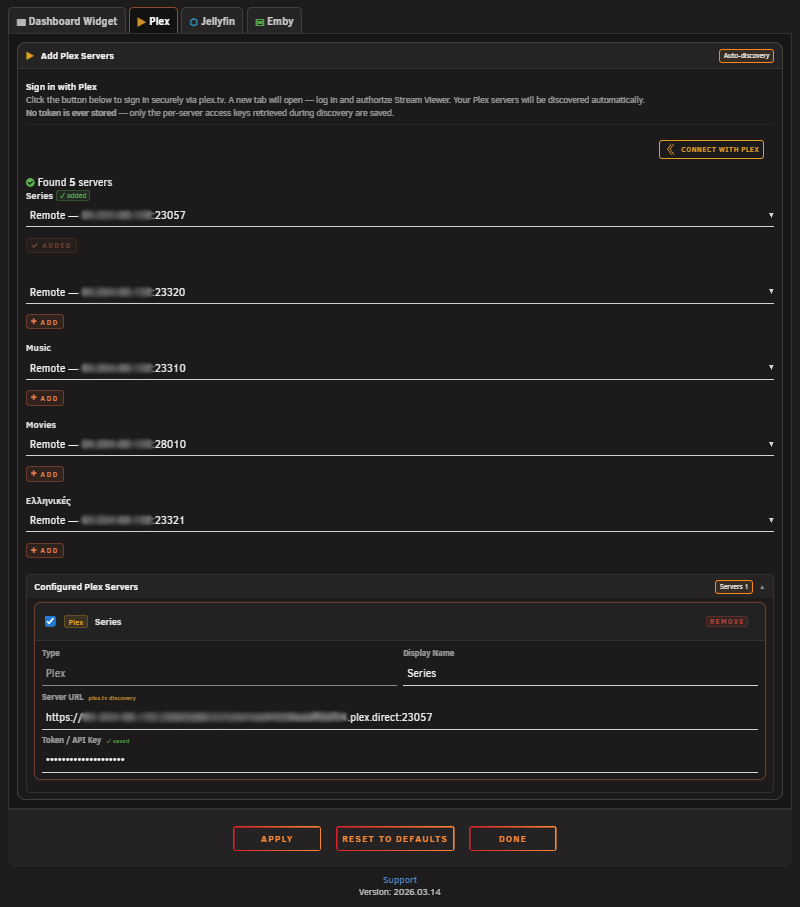
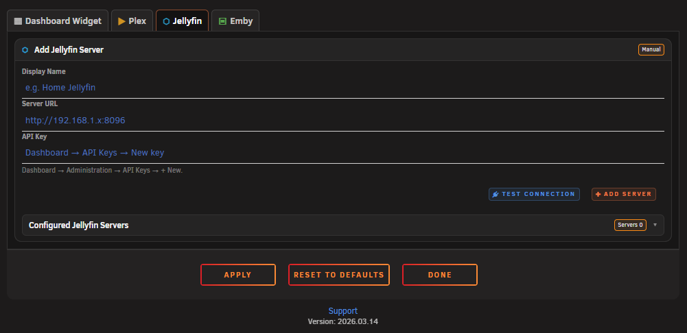

## Development

**Requirements**
- Unraid 7.2.0 or later
- Bash, tar with xz, md5sum or md5, and base64 for the local build (for build script)
- xmllint is optional and checks the generated plg

**Build**

```bash
# Release build
./build.sh

# Dev build
./build.sh "" dev

# Local build (embedded package, no internet required)
./build.sh "" "" local

# Release with letter suffix (e.g. 2026.03.13a)
./build.sh a
```

The version is the build date. The build writes `packages/streamviewer-<version>.txz` and `streamviewer.plg`. A release build stops unless the top entry of CHANGELOG.md is the version being built.

**Project Structure**

```
unraid-streamviewer/
├── source/
│   ├── css/
│   │   ├── widget.css
│   │   ├── settings.css
│   │   └── tool.css
│   ├── js/
│   │   ├── streamviewer-core.js
│   │   ├── streamviewer-widget.js
│   │   ├── streamviewer-live.js
│   │   ├── streamviewer-tool.js
│   │   ├── streamviewer-header.js
│   │   └── chart.min.js
│   ├── include/
│   │   ├── streamviewer_api.php
│   │   ├── streamviewer_cron.php
│   │   ├── streamviewer_header.php
│   │   └── streamviewer_poll.sh
│   ├── img/
│   │   ├── streamviewer.png
│   │   ├── streamviewerplugin.png
│   │   └── avatar.png
│   ├── icons/
│   │   └── cast.svg
│   ├── event/
│   │   ├── started
│   │   └── stopped
│   ├── StreamViewer.page
│   ├── StreamViewerButton.page
│   ├── StreamViewerSettings.page
│   ├── StreamViewerTool.page
│   ├── ViewersSuite.page
│   └── README.md
├── screenshots/
│   └── pc/
├── mockups/
├── tools/
│   └── make_mockups.py
├── build.sh
├── ca_profile.xml
├── CHANGELOG.md
├── GUIDE.md
├── README.md
├── streamviewer.plg
├── streamviewer.xml
└── LICENSE
```

| Path | What it is |
| --- | --- |
| `StreamViewer.page` | Dashboard tile |
| `StreamViewerButton.page`, `streamviewer-header.js`, `streamviewer_header.php` | Stream count icon in the header bar |
| `StreamViewerSettings.page` | Settings page |
| `StreamViewerTool.page`, `streamviewer-tool.js` | Statistics page |
| `ViewersSuite.page` | Viewers Suite group in the Tools menu |
| `streamviewer-core.js` | Stream list shared by the tile (`streamviewer-widget.js`) and the Active Stream/s tab (`streamviewer-live.js`) |
| `streamviewer_api.php` | API for the pages and the recorder |
| `streamviewer_poll.sh`, `streamviewer_cron.php`, `event/` | Recorder for watch history, started and stopped with the array |
| `mockups/`, `tools/make_mockups.py` | Drawings of the guide and the script that makes them |

## Changelog

See [CHANGELOG.md](https://github.com/Lazaros-Chalkidis/unraid-streamviewer/blob/main/CHANGELOG.md) for version history.

## Issues and Support

To suggest features, report bugs or share feedback, open an issue on [GitHub](https://github.com/Lazaros-Chalkidis/unraid-streamviewer/issues).

## Author

Lazaros Chalkidis
[GitHub](https://github.com/Lazaros-Chalkidis)

## License

Copyright (C) 2026 Stream Viewer Unraid Plugin, Lazaros Chalkidis

Licensed under the GNU General Public License v3.0 or later (GPL-3.0-or-later).
See the LICENSE file for the full license text.
